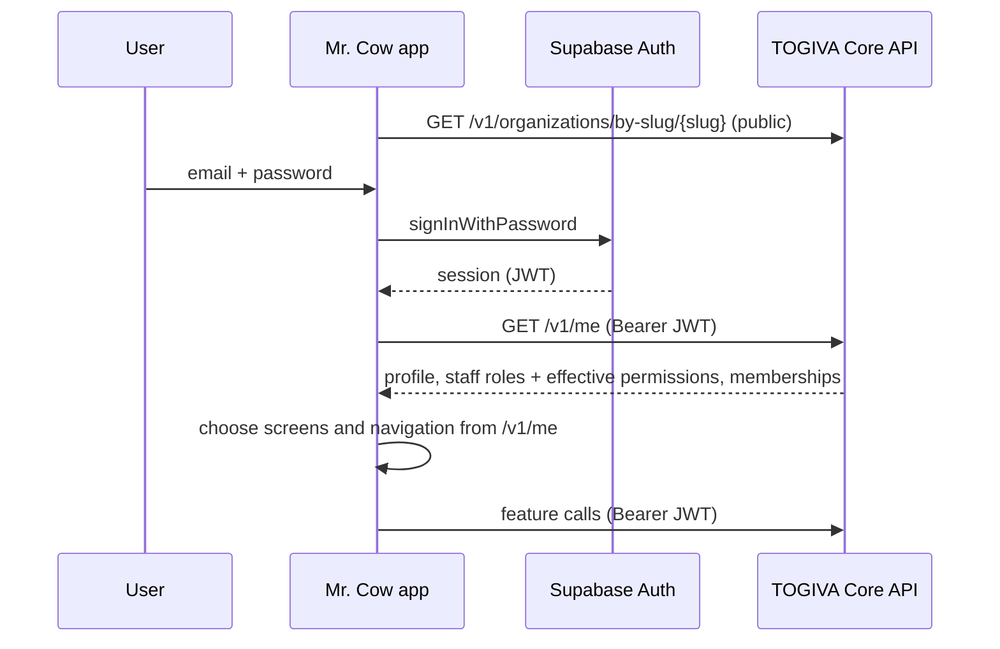

# Architecture

## Boundaries

- **TOGIVA Core** owns the database, business rules, permissions and integrations. It knows nothing about Mr. Cow's look.
- **This repository** owns Mr. Cow's experiences: screens, copy, brand, and app configuration. It calls TOGIVA Core's v1 API with the signed-in user's token and never touches the database or re-implements a rule.
- Client-side permission checks only decide what to *show*. TOGIVA Core authorizes every request again on the server.

## Request flow

## Which app a user gets

| App | Allowed when | Navigation is filtered by |
| --- | --- | --- |
| Customer PWA | Any signed-in user; membership state comes from `customerMemberships` | n/a (customer features are the same for every member) |
| Franchise portal | Staff access to at least one location of the organization | Permissions at the **active store** (store switcher re-evaluates) |
| Corporate console | Any organization-level permission (corporate roles) | Organization-level permissions |

Direct links to a screen outside the user's permissions show an explanation instead of the screen.

## Brand and themes

`@mrcow/brand-config` holds the palette (`#E2592A` orange, `#F2C83D` yellow, `#E8A83A` gold, `#FAE8D2` cream, `#15100D` ink), fonts (Archivo 900 at 125% width for headlines, Bricolage Grotesque for body, Sacramento for script accents), the 28px radius, the hard `6px 6px 0` ink shadow and the logo, all from the Mr. Cow website. It exposes two themes:

- **consumer** (customer PWA): the website's menu-board look translated to an app.
- **operations** (franchise, corporate): same palette and type family, quieter borders and shadows for dense daily use.

Status colours (success, warning, danger) are functional additions, not brand colours. A test keeps every text/background pairing at WCAG AA contrast or better.

## API types

`packages/shared-types/openapi/v1.json` is a copy of TOGIVA Core's published contract. Types are generated from it with openapi-typescript and the client uses openapi-fetch, so a contract change shows up as a type error here. Routes TOGIVA marks `x-togiva-status: planned` have fixed shapes but are not served yet; the apps don't call them until they ship.

## Offline and installation (customer PWA)

`vite-plugin-pwa` generates the web manifest (icons from the Mr. Cow cow badge) and a Workbox service worker that precaches the app shell and falls back to it for navigation. API responses are never cached, so balances and codes are always live.
